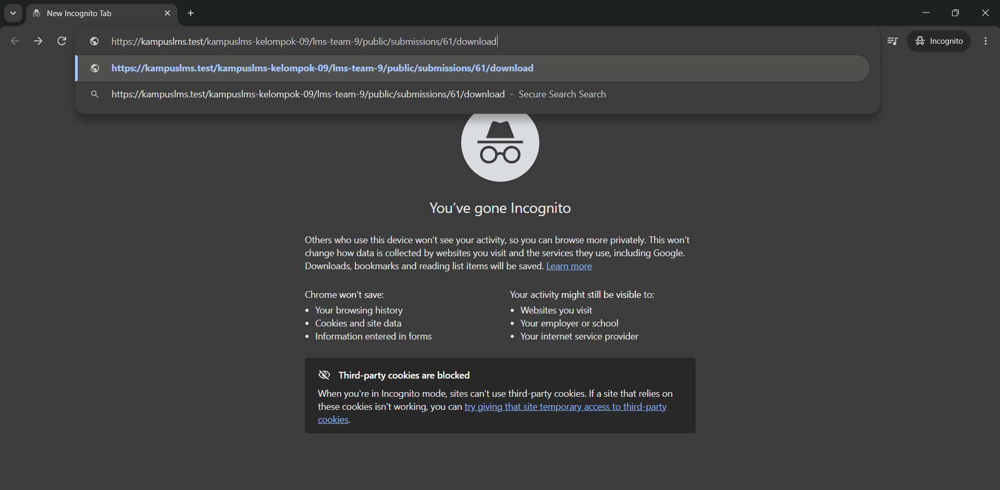
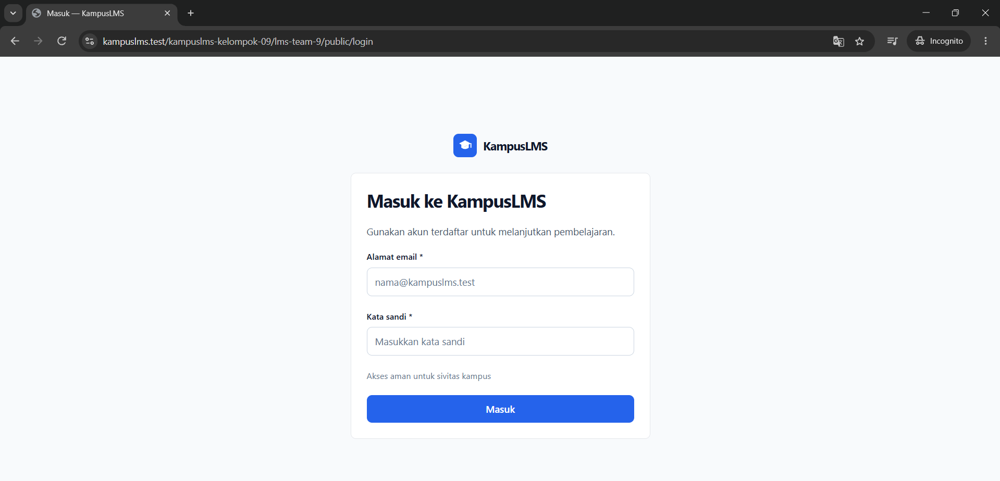

## Deployment publik dengan Docker dan HTTPS otomatis

Panduan ini menjalankan aplikasi di satu VPS Ubuntu dengan Docker. Caddy menjadi reverse proxy dan memperoleh/memperbarui sertifikat TLS otomatis. Database SQLite, berkas unggahan, dan data sertifikat disimpan di Docker volumes sehingga bertahan saat container aplikasi diganti. Queue worker berjalan dalam container terpisah dari web.

> **Status:** aplikasi publik saat ini tersedia di [kampuslms-kelompok-09-production.up.railway.app](https://kampuslms-kelompok-09-production.up.railway.app/); pemeriksaan dari workspace mendapatkan HTTP 200 pada halaman utama dan endpoint `/up` melalui HTTPS. Skrip `deploy.sh` di bawah adalah prosedur alternatif untuk self-host di VPS Ubuntu, bukan mekanisme deploy Railway. Akses ke konfigurasi/proyek Railway tidak tersedia dari workspace ini.

### Spesifikasi server

- Ubuntu Server 24.04 LTS, arsitektur 64-bit.
- Minimum untuk demonstrasi/beban ringan: 2 vCPU, RAM 4 GB, SSD 40 GB.
- Docker Engine, Git, dan curl.
- Domain publik dengan rekaman DNS `A` yang menunjuk ke alamat IPv4 VPS. Persyaratan ini hanya untuk prosedur VPS di bawah; domain Railway yang sedang aktif dikelola oleh Railway.
- Port TCP 80 dan 443 dapat diakses dari internet; port UDP 443 opsional untuk HTTP/3. Batasi SSH (TCP 22) ke alamat administrator bila memungkinkan.
- SQLite dalam Docker volume sesuai untuk deployment satu server dan beban ringan. Untuk banyak worker atau beberapa app server, gunakan database terkelola dan tinjau konfigurasi storage bersama terlebih dahulu.

### Langkah deployment pertama dari nol

#### 1. Siapkan VPS dan DNS

Buat VPS Ubuntu 24.04 dan catat alamat IP publiknya. Di pengelola DNS domain, buat rekaman `A` untuk nama host aplikasi, misalnya `lms.example.edu`, dengan nilai IP VPS. Tunggu propagasi DNS.

Masuk ke VPS melalui SSH, lalu pasang Docker dan alat yang dibutuhkan:

```bash
sudo apt update
sudo apt install -y docker.io git curl
sudo systemctl enable --now docker
sudo usermod -aG docker "$USER"
```

Keluar lalu masuk kembali melalui SSH agar keanggotaan grup Docker berlaku, kemudian verifikasi:

```bash
docker info
```

Konfigurasikan firewall provider dan firewall VPS agar port 80/tcp, 443/tcp, dan (opsional) 443/udp terbuka. Jangan membuka port aplikasi 8080 ke internet; hanya container Caddy yang memublikasikan port.

#### 2. Ambil source code

```bash
git clone https://github.com/ToroAbabil/kampuslms-kelompok-09.git
cd kampuslms-kelompok-09/lms-team-9
```

#### 3. Buat environment production

Salin template, lalu edit berkas di server. Jangan commit atau mengirim berkas ini:

```bash
cp .env.example .env.production
chmod 600 .env.production
nano .env.production
```

Atur sekurang-kurangnya nilai berikut. Buat `APP_KEY` unik dengan `php artisan key:generate --show` jika PHP tersedia di server, atau dengan `printf 'base64:%s\n' "$(openssl rand -base64 32)"`; salin hasilnya sebagai nilai `APP_KEY`.

```dotenv
APP_ENV=production
APP_KEY=base64:GANTI_DENGAN_KUNCI_UNIK
APP_DEBUG=false
APP_URL=https://lms.example.edu
LOG_CHANNEL=stack
LOG_LEVEL=error
DB_CONNECTION=sqlite
DB_DATABASE=/var/www/html/database/data/database.sqlite
CACHE_STORE=database
SESSION_DRIVER=database
SESSION_SECURE_COOKIE=true
QUEUE_CONNECTION=database
```

Ganti `lms.example.edu` dengan domain sebenarnya di `APP_URL` dan perintah deployment. Gunakan password demo non-default jika seeder produksi memang diperlukan; jangan gunakan akun/password demo development. Atur SMTP secara terpisah jika email produksi dibutuhkan. Skrip deployment hanya menjalankan migrasi, bukan seeder.

#### 4. Build, migrasikan, dan aktifkan HTTPS

Pastikan DNS sudah mengarah ke VPS dan port 80/443 terbuka, lalu jalankan dari direktori aplikasi:

```bash
DOMAIN=lms.example.edu bash ./deploy.sh
```

Skrip memvalidasi konfigurasi production, membangun image aplikasi, menjalankan migrasi, menyalakan worker antrean dalam container terpisah, memasang Caddy, lalu memeriksa `https://<domain>/up`. Caddy perlu dapat menerima koneksi pada port 80/443 untuk menerbitkan sertifikat. Jangan jalankan skrip ini untuk service Railway atau dari workstation Windows; jalankan hanya pada VPS Linux yang memang akan di-self-host.

Verifikasi hasil:

```bash
curl -I https://lms.example.edu
docker ps
docker ps --filter name=kampuslms-queue
docker logs --tail 50 kampuslms-queue
```

Setelah health check berhasil, cantumkan URL HTTPS aktual pada bagian **Aplikasi live** di README. Jangan mengganti placeholder dengan `kampuslms.test`, `localhost`, atau URL yang belum diverifikasi.

### Deployment ulang

Jalankan di VPS dari direktori aplikasi:

```bash
git pull --ff-only
DOMAIN=lms.example.edu bash ./deploy.sh
```

Skrip membangun image baru, mengganti container aplikasi dan queue worker, menjalankan migrasi, lalu memasang ulang Caddy. Docker volumes `kampuslms-database`, `kampuslms-storage`, `kampuslms-caddy-data`, dan `kampuslms-caddy-config` tidak dihapus saat deployment ulang. Jangan menghapus volume tersebut saat membersihkan container. Buat backup sebelum migrasi yang berisiko; untuk SQLite, hentikan sementara container `kampuslms` dan `kampuslms-queue`, lalu salin file database dari volume sebelum meneruskan.

### Membaca log dan status layanan

```bash
# Log Apache dari container aplikasi
docker logs --tail 200 kampuslms
docker logs --follow kampuslms

# Log queue worker yang berjalan di container terpisah
docker logs --tail 200 kampuslms-queue
docker logs --follow kampuslms-queue
docker top kampuslms-queue

# Log Caddy, termasuk kegagalan DNS atau penerbitan sertifikat
docker logs --tail 200 kampuslms-proxy
docker logs --follow kampuslms-proxy

# Log Laravel di volume storage
docker exec kampuslms sh -c 'tail -n 200 storage/logs/laravel.log'

# Status migrasi
docker exec --user www-data kampuslms php artisan migrate:status
```

Apache berjalan di container aplikasi dan queue worker di container terpisah; keluaran keduanya dapat dibaca dengan `docker logs`. Log Laravel juga tersedia di `storage/logs/laravel.log`. Hindari menyalin log yang berisi data pengguna atau rahasia ke laporan publik.

### Masalah yang ditemui saat persiapan dan cara mengatasinya

| Masalah/temuan | Dampak | Cara mengatasi |
|---|---|---|
| Docker CLI tidak terpasang pada workstation Windows tempat panduan disiapkan. | Image VPS tidak dapat dibangun atau diuji di workstation ini. Aplikasi live Railway tetap dapat diakses, tetapi deployment VPS belum diuji end-to-end. | Jalankan skrip di VPS Ubuntu setelah Docker Engine terpasang dan `docker info` berhasil. Validasi lokal skrip mencakup pemeriksaan sintaks Bash dan simulasi Docker; verifikasi nyata VPS tetap diperlukan. |
| URL `kampuslms.test` dalam catatan pemeriksaan lama adalah domain lokal, bukan domain yang dapat diakses publik atau memperoleh sertifikat publik. | Tautan lokal tidak memenuhi syarat aplikasi live HTTPS. | Siapkan domain publik, arahkan DNS `A` ke IP VPS, buka port 80/443, lalu gunakan nama domain yang sama pada `APP_URL` dan `DOMAIN`. |
| Template `.env.example` memakai `APP_URL=http://localhost` dan database SQLite dengan lokasi relatif. | URL produksi/cookie HTTPS dan lokasi database persisten tidak sesuai untuk container produksi. | Gunakan `.env.production` yang tidak dilacak Git; set `APP_URL=https://<domain>`, `SESSION_SECURE_COOKIE=true`, dan lokasi database absolut pada Docker volume seperti contoh di atas. |
| Dockerfile menjalankan `apache2-foreground` langsung; konfigurasi Supervisor yang disalin ke image tidak dijalankan oleh perintah container saat ini. | Queue worker tidak otomatis hidup hanya karena konfigurasi Supervisor ada di image. | Skrip menjalankan `queue:work` dalam container `kampuslms-queue` tersendiri, dengan database dan storage volume yang sama; tidak perlu mengubah source aplikasi. |
| Konfigurasi dan akses proyek Railway tidak tersedia di workspace ini. | URL live berhasil diperiksa secara publik, tetapi variabel environment, sumber database, backup, dan riwayat deployment Railway tidak dapat diverifikasi. | Periksa deployment/logs dan environment variables dari Railway dashboard/CLI milik pemilik proyek; jangan mengirim password, private key, atau token melalui chat/repository. README kini mencantumkan URL HTTPS yang telah diuji. |

### Troubleshooting deployment

| Gejala | Pemeriksaan dan solusi |
|---|---|
| `docker info` gagal atau skrip melaporkan daemon tidak dapat diakses | Jalankan `sudo systemctl status docker`; aktifkan dengan `sudo systemctl enable --now docker`. Jika baru menambahkan user ke grup `docker`, logout/login ulang. |
| Caddy gagal menerbitkan sertifikat atau HTTPS health check timeout | Pastikan DNS publik menunjuk ke IP VPS (`dig +short <domain>`), port TCP 80/443 terbuka di firewall provider dan VPS, serta tidak ada layanan lain yang memakai port tersebut. Baca `docker logs --tail 200 kampuslms-proxy`. |
| Migrasi gagal atau SQLite tidak dapat ditulis | Pastikan `.env.production` memakai `DB_CONNECTION=sqlite` dan lokasi absolut yang diwajibkan skrip. Periksa `docker logs kampuslms`; skrip mengatur pemilik direktori database ke `www-data` sebelum migrasi. |
| Queue worker berhenti | Periksa `docker ps -a --filter name=kampuslms-queue` dan `docker logs --tail 200 kampuslms-queue`. Pastikan migrasi tabel jobs berhasil; setelah memperbaiki penyebabnya jalankan ulang deployment. |
| Migrasi gagal atau tabel migrasi tidak ditemukan | Pastikan volume database hanya dipasang pada `/var/www/html/database/data`; jangan menutupi direktori `/var/www/html/database` yang berisi file migrasi. Skrip menggunakan mount subdirektori agar file migrasi tetap tersedia. |
| Perubahan source tidak tampak setelah `git pull` | Pastikan pull dilakukan pada branch yang benar dan build selesai tanpa error; skrip membangun image dari source lokal sebelum mengganti container. Periksa `docker ps` dan `docker logs kampuslms`. |

> Bagian checklist di bawah merupakan catatan pemeriksaan lingkungan Laragon/WSL sebelumnya, bukan langkah menjalankan deployment Docker VPS di atas. Untuk deployment VPS, gunakan container `kampuslms-queue`; konfigurasi Supervisor yang disalin ke image tidak dijalankan oleh `CMD` Dockerfile saat ini.

## Periksa Keamanan Produksi
1. APP_DEBUG=false
   Sudah di ubah di env

2. APP_ENV=production
   sudah di ubah di env
   
    Jika Anda baru mengubah .env, Laravel mungkin masih menyimpan nilai lama di cache. Jalankan perintah ini di terminal PowerShell (di folder proyek): 

      ``` 
      php artisan config:clear
      php artisan config:cache
      ```
   Jalankan perintah berikut untuk mengecek
   ```
   php artisan tinker --execute="dump(config('app.env'), config('app.debug'));"
   ```
3. curl.exe -k -I https://kampuslms.test/kampuslms-kelompok-09/lms-team-9/public/.env → 404 atau 403, tidak boleh 200/

   Uji file tersembunyi (termasuk `.gitignore`) pada domain publik:
   ```
   curl.exe -sS -o NUL -w "%{http_code}`n" https://kampuslms-kelompok-09-production.up.railway.app/storage/debugbar/.gitignore
   ```
   Hasil yang diperiksa saat ini: `404`. Aturan `.htaccess` juga menolak dotfiles dengan `403`; jalankan ulang pemeriksaan setelah perubahan source ter-deploy.

Hasil  
HTTP/1.1 404 Not Found


4. curl -I https://domain/storage/logs/laravel.log → 404 atau 403, tidak boleh 200

Hasil  
HTTP/1.1 404 Not Found


5. HTTPS aktif, HTTP dialihkan ke HTTPS

   Pertama : Enable ssl di laragon  
   Ked : buka .htaccess tambahkan kode berikut untuk periksa redirect:  
   ```
   <IfModule mod_rewrite.c>
    RewriteEngine On
    RewriteCond %{HTTPS} off
    RewriteRule ^(.*)$ https://%{HTTP_HOST}%{REQUEST_URI} [L,R=301]
   </IfModule>
   ```
Untuk mengecek  
```
curl.exe -I http://kampuslms.test/kampuslms-kelompok-09/lms-team-9/public/
```
Hasil  
HTTP/1.1 301 Moved Permanently  
Date: Mon, 09 Nov 2026 14:04:25 GMT  
Server: Apache/2.4.54 (Win64) OpenSSL/1.1.1q mod_fcgid/2.3.10-dev  
Location: https://kampuslms.test/kampuslms-kelompok-09/lms-team-9/public  
Content-Type: text/html; charset=iso-8859-1


6. SESSION_SECURE_COOKIE=true

   Sudah di env

7. Kata sandi database bukan kata sandi lokal, dan bukan password

DB_CONNECTION=mysql  
DB_HOST=127.0.0.1  
DB_PORT=3306  
DB_DATABASE=kampuslms  
DB_USERNAME=kampuslms_user  
DB_PASSWORD=GANTI_DENGAN_PASSWORD_UNIK

8.  Akun demo memakai kata sandi yang berbeda dari contoh di dokumentasi


 - Buka browser, akses aplikasi Anda: https://kampuslms.test/kampuslms-kelompok-09/lms-team-9/public/login

- Login menggunakan akun demo. Coba cek di file DemoAccountSeeder.php untuk melihat email akun demo (biasanya admin@kampuslms.test atau dosen@kampuslms.test).

- Masukkan password demo non-default yang Anda set di `.env`; jangan menyalin nilainya ke dokumentasi atau laporan.

- Jika berhasil masuk ke halaman Dashboard, berarti Ceklis 8 LULUS.

9.  Skrip pengujian otorisasi dari minggu 7 dijalankan terhadap server produksi dan seluruhnya lolos

Melakukan pengujiannya di scripts\test-authz.sh

10.  Berkas submission tidak bisa diunduh tanpa login — diuji dari jendela penyamaran
   
sebelum



sesudah



11. Queue worker berjalan lewat Supervisor, dibuktikan dengan supervisorctl status


12. upload_max_filesize dan post_max_size di server sesuai validasi aplikasi

cara mengeceknya 
``` 
curl.exe -k -s https://kampuslms.test/kampuslms-kelompok-09/lms-team-9/public/_php-upload-check.php
```
jangan lupa ubah php.ini menjadi upload_max_filesize = 20M dan post_max_size = 24M.


NOTE:
Buat langkah 11

# Panduan Lengkap Ceklis 11: Queue Worker & Supervisor (WSL)

**Tujuan:** Membuktikan bahwa Queue Worker berjalan menggunakan process manager Supervisor di environment Linux (WSL), dibuktikan dengan output `supervisorctl status` yang berstatus `RUNNING`.

**Prasyarat:** 
- Proyek Laravel (Laragon) sudah berjalan di Windows.
- Pengguna memiliki akses Administrator di laptop Windows.

---

## TAHAP 1: Instalasi Ubuntu (WSL) di Windows

1. Buka **Start Menu**, ketik `PowerShell`.
2. Klik kanan pada **Windows PowerShell**, lalu pilih **Run as Administrator**.
3. Jalankan perintah berikut di PowerShell:
   ```powershell
   wsl --install -d Ubuntu
   ```
4. Tunggu proses unduh dan instalasi selesai, lalu **Restart laptop** Anda.
5. Setelah menyala, buka **Start Menu**, cari dan buka aplikasi **Ubuntu**.
6. Tunggu proses inisialisasi (*Installing...*). Anda akan diminta membuat **Username** (huruf kecil semua) dan **Password**.
   > ⚠️ **Penting:** Saat mengetik password di terminal Linux, layar tidak akan menampilkan karakter apa pun (tidak ada bintang/titik). Ini adalah hal normal. Langsung ketik dan tekan Enter.
7. Jika sudah muncul prompt seperti `namamu@namalaptop:~$`, instalasi WSL berhasil.

---

## TAHAP 2: Instalasi PHP & Supervisor di Ubuntu

Di terminal Ubuntu yang baru terbuka, jalankan perintah berikut satu per satu (tekan Enter setelahnya):

```bash
sudo apt update && sudo apt upgrade -y
```
```bash
sudo apt install php-cli php-mbstring php-xml php-curl unzip supervisor -y
```
*(Masukkan password Ubuntu Anda jika diminta, lalu tunggu hingga proses selesai).*

---

## TAHAP 3: Konfigurasi Supervisor

1. Buka file konfigurasi baru menggunakan editor nano:
   ```bash
   sudo nano /etc/supervisor/conf.d/laravel-worker.conf
   ```

2. **Copy-paste** teks di bawah ini ke dalam editor nano:
   > ⚠️ **PENTING:** Sesuaikan path `/mnt/c/laragon/www/kampuslms/kampuslms-kelompok-09/lms-team-9/` dengan lokasi folder proyek Laravel Anda di Windows.

   ```ini
   [program:laravel-worker]
   process_name=%(program_name)s_%(process_num)02d
   command=php /mnt/c/laragon/www/kampuslms/kampuslms-kelompok-09/lms-team-9/artisan queue:work --sleep=3 --tries=3
   autostart=true
   autorestart=true
   user=root
   numprocs=1
   redirect_stderr=true
   stdout_logfile=/var/log/laravel-worker.log
   stopwaitsecs=3600
   ```

3. **Simpan dan Keluar:**
   - Tekan **`Ctrl + O`** (huruf O).
   - Tekan **`Enter`**.
   - Tekan **`Ctrl + X`**.

---

## TAHAP 4: Menjalankan Supervisor & Mengambil Bukti

1. Jalankan perintah ini untuk memuat konfigurasi baru:
   ```bash
   sudo supervisorctl reread
   sudo supervisorctl update
   sudo supervisorctl start laravel-worker:*
   ```

2. Jalankan perintah untuk melihat status:
   ```bash
   sudo supervisorctl status
   ```

3. **TARGET KEBERHASILAN:**
   Output terminal harus menampilkan teks dengan status **RUNNING** seperti contoh di bawah:
   ```text
   laravel-worker:laravel-worker_00   RUNNING   pid 1234, uptime 0:00:21
   ```

4. **BUKTI LAPORAN:**
   Ambil *screenshot* layar terminal Ubuntu yang menampilkan status `RUNNING` tersebut. Simpan gambar di folder `docs/` dengan nama `bukti-supervisor.png`.

---

## TROUBLESHOOTING

*   **Status `FATAL` atau `BACKOFF`:**
    Worker gagal berjalan. Periksa log dengan perintah `sudo tail -f /var/log/laravel-worker.log`. Penyebab umum: Database MySQL di Laragon Windows sedang mati, atau path folder proyek di Tahap 3 salah ketik.
*   **Error `php: command not found`:**
    Instalasi PHP terputus. Jalankan ulang `sudo apt install php-cli`.
*   **Lupa Password Ubuntu:**
    Buka PowerShell (Admin), ketik `wsl -u root`, lalu jalankan perintah `passwd namauseranda` untuk membuat password baru.

---

# Panduan Ceklis 7: Ganti Password Database (Dari Nol)

**Tujuan:** Membuktikan bahwa aplikasi tidak memakai user default (`root`) dan password kosong, melainkan user khusus dengan password yang kuat.

---

## TAHAP 1: Membuat User Baru di phpMyAdmin

1. Buka **Laragon**, klik tombol **Database** (atau buka browser ke `http://localhost/phpmyadmin`).
2. Login dengan Username: `root`, Password: *(kosongkan saja)*.
3. Setelah masuk, klik tab **User accounts** di bagian atas layar.
4. Klik tombol **Add user account** (Tambahkan akun pengguna).
5. Isi form persis seperti ini:
   - **User name:** Pilih `Use text field`, isi dengan: `kampuslms_user`
   - **Host name:** Pilih **Local** dari dropdown (kotak isian akan otomatis menjadi `localhost`).
   - **Password:** Pilih `Use text field`, isi dengan password kuat, contoh: `RahasiaKampus2026!`
   - **Re-type:** Ketik ulang password yang persis sama.
6. **PENTING (Scroll ke bawah):** 
   - Pada bagian *Database for user account*, **JANGAN** centang opsi "Create database with same name...".
   - Centang opsi **"Grant all privileges on database kampuslms"** (pilih database `kampuslms` jika ada dropdown).
7. Klik tombol **Go** di kanan bawah.
8. Jika berhasil, akan muncul tulisan hijau **"You have added a new user"**.

---

## TAHAP 2: Memberikan Hak Akses (Jika Belum)
*(Lakukan ini jika saat membuat user tadi Anda melewatkan centang database)*
1. Masih di tab **User accounts**, cari user `kampuslms_user`.
2. Klik **Edit privileges** di sebelah kanannya.
3. Klik tab **Database**.
4. Di dropdown *"Add privileges on the following database"*, pilih `kampuslms`, lalu klik **Go**.
5. Centang kotak **Check all**, lalu klik **Go** untuk menyimpan.

---

## TAHAP 3: Mengubah File `.env` Laravel

1. Buka proyek Laravel Anda di VS Code.
2. Buka file `.env`.
3. Cari baris berikut dan ubah nilainya:
   ```env
   DB_USERNAME=kampuslms_user
   DB_PASSWORD=GANTI_DENGAN_PASSWORD_UNIK
   ```
4. Simpan file.

---

## TAHAP 4: Uji Koneksi (Ambil Bukti)

1. Buka **PowerShell** di folder proyek.
2. Jalankan perintah untuk membersihkan cache lama:
   ```powershell
   php artisan config:clear
   ```
3. Jalankan perintah untuk mengecek koneksi database:
   ```powershell
   php artisan migrate:status
   ```

**Target Keberhasilan:**
Muncul tabel daftar migrasi di terminal (ada tulisan *Migration name*, *Batch*, *Status*). Jika muncul error *Access Denied*, berarti password di `.env` salah ketik.

---

## TAHAP 5: Memasukkan ke Laporan `docs/deployment.md`

Copy output dari `php artisan migrate:status` tadi, lalu tempel ke file laporan Anda:

```markdown
### 7. Kata sandi database bukan kata sandi lokal, dan bukan password
**Bukti:**
Aplikasi telah dikonfigurasi menggunakan user database khusus (`kampuslms_user`) dengan password yang kuat. Koneksi database dibuktikan dengan perintah migrasi status.

**Perintah:**
`php artisan migrate:status`

**Output:**
```text
  Migration name .............................................. Batch / Status
  0001_01_01_000000_create_users_table ........................ [1] Ran
  0001_01_01_000001_create_cache_table ........................ [1] Ran
  0001_01_01_000002_create_jobs_table ......................... [1] Ran
  ...
```
```