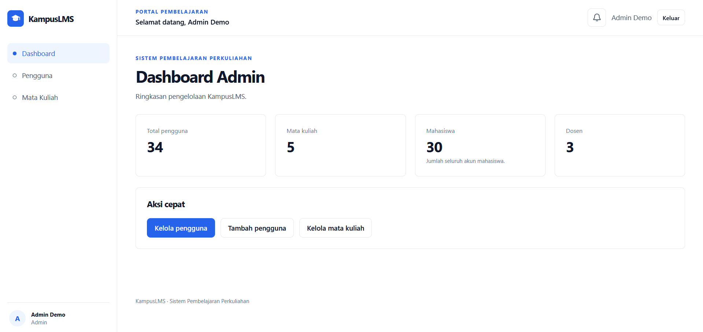
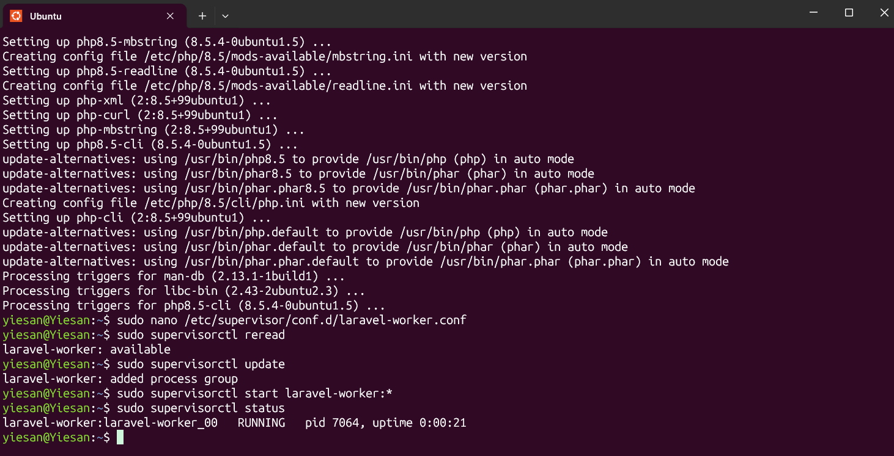

## Periksa Keamanan Produksi
1. APP_DEBUG=false
   Sudah di ubah di env

2. APP_ENV=production
   sudah di ubah di env
   
    Jika Anda baru mengubah .env, Laravel mungkin masih menyimpan nilai lama di cache. Jalankan perintah ini di terminal PowerShell (di folder proyek): 

      ``` 
      php artisan config:clear
      php artisan config:cache
      ```
   Jalankan perintah berikut untuk mengecek
   ```
   php artisan tinker --execute="dump(config('app.env'), config('app.debug'));"
   ```
3. curl.exe -k -I https://kampuslms.test/kampuslms-kelompok-09/lms-team-9/public/.env → 404 atau 403, tidak boleh 200/

Hasil  
HTTP/1.1 404 Not Found


4. curl -I https://domain/storage/logs/laravel.log → 404 atau 403, tidak boleh 200

Hasil  
HTTP/1.1 404 Not Found


5. HTTPS aktif, HTTP dialihkan ke HTTPS

   Pertama : Enable ssl di laragon  
   Ked : buka .htaccess tambahkan kode berikut untuk periksa redirect:  
   ```
   <IfModule mod_rewrite.c>
    RewriteEngine On
    RewriteCond %{HTTPS} off
    RewriteRule ^(.*)$ https://%{HTTP_HOST}%{REQUEST_URI} [L,R=301]
   </IfModule>
   ```
Untuk mengecek  
```
curl.exe -I http://kampuslms.test/kampuslms-kelompok-09/lms-team-9/public/
```
Hasil  
HTTP/1.1 301 Moved Permanently  
Date: Mon, 09 Nov 2026 14:04:25 GMT  
Server: Apache/2.4.54 (Win64) OpenSSL/1.1.1q mod_fcgid/2.3.10-dev  
Location: https://kampuslms.test/kampuslms-kelompok-09/lms-team-9/public  
Content-Type: text/html; charset=iso-8859-1


6. SESSION_SECURE_COOKIE=true

   Sudah di env

7. Kata sandi database bukan kata sandi lokal, dan bukan password

DB_CONNECTION=mysql  
DB_HOST=127.0.0.1  
DB_PORT=3306  
DB_DATABASE=kampuslms  
DB_USERNAME=kampuslms_user  
DB_PASSWORD=RahasiaKampus2026

8.  Akun demo memakai kata sandi yang berbeda dari contoh di dokumentasi



 - Buka browser, akses aplikasi Anda: https://kampuslms.test/kampuslms-kelompok-09/lms-team-9/public/login

- Login menggunakan akun demo. Coba cek di file DemoAccountSeeder.php untuk melihat email akun demo (biasanya admin@kampuslms.test atau dosen@kampuslms.test).

- Masukkan password: DemoRahasia123! (sesuai yang Anda set di .env).

- Jika berhasil masuk ke halaman Dashboard, berarti Ceklis 8 LULUS.

9.  Skrip pengujian otorisasi dari minggu 7 dijalankan terhadap server produksi dan seluruhnya lolos

Melakukan pengujiannya di scripts\test-authz.sh

10.  Berkas submission tidak bisa diunduh tanpa login — diuji dari jendela penyamaran
   
sebelum


sesudah


11. Queue worker berjalan lewat Supervisor, dibuktikan dengan supervisorctl status


12. upload_max_filesize dan post_max_size di server sesuai validasi aplikasi

cara mengeceknya 
``` 
curl.exe -k -s https://kampuslms.test/kampuslms-kelompok-09/lms-team-9/public/_php-upload-check.php
```
jangan lupa ubah php.ini menjadi upload_max_filesize = 20M dan post_max_size = 24M.


NOTE:
Buat langkah 11

# Panduan Lengkap Ceklis 11: Queue Worker & Supervisor (WSL)

**Tujuan:** Membuktikan bahwa Queue Worker berjalan menggunakan process manager Supervisor di environment Linux (WSL), dibuktikan dengan output `supervisorctl status` yang berstatus `RUNNING`.

**Prasyarat:** 
- Proyek Laravel (Laragon) sudah berjalan di Windows.
- Pengguna memiliki akses Administrator di laptop Windows.

---

## TAHAP 1: Instalasi Ubuntu (WSL) di Windows

1. Buka **Start Menu**, ketik `PowerShell`.
2. Klik kanan pada **Windows PowerShell**, lalu pilih **Run as Administrator**.
3. Jalankan perintah berikut di PowerShell:
   ```powershell
   wsl --install -d Ubuntu
   ```
4. Tunggu proses unduh dan instalasi selesai, lalu **Restart laptop** Anda.
5. Setelah menyala, buka **Start Menu**, cari dan buka aplikasi **Ubuntu**.
6. Tunggu proses inisialisasi (*Installing...*). Anda akan diminta membuat **Username** (huruf kecil semua) dan **Password**.
   > ⚠️ **Penting:** Saat mengetik password di terminal Linux, layar tidak akan menampilkan karakter apa pun (tidak ada bintang/titik). Ini adalah hal normal. Langsung ketik dan tekan Enter.
7. Jika sudah muncul prompt seperti `namamu@namalaptop:~$`, instalasi WSL berhasil.

---

## TAHAP 2: Instalasi PHP & Supervisor di Ubuntu

Di terminal Ubuntu yang baru terbuka, jalankan perintah berikut satu per satu (tekan Enter setelahnya):

```bash
sudo apt update && sudo apt upgrade -y
```
```bash
sudo apt install php-cli php-mbstring php-xml php-curl unzip supervisor -y
```
*(Masukkan password Ubuntu Anda jika diminta, lalu tunggu hingga proses selesai).*

---

## TAHAP 3: Konfigurasi Supervisor

1. Buka file konfigurasi baru menggunakan editor nano:
   ```bash
   sudo nano /etc/supervisor/conf.d/laravel-worker.conf
   ```

2. **Copy-paste** teks di bawah ini ke dalam editor nano:
   > ⚠️ **PENTING:** Sesuaikan path `/mnt/c/laragon/www/kampuslms/kampuslms-kelompok-09/lms-team-9/` dengan lokasi folder proyek Laravel Anda di Windows.

   ```ini
   [program:laravel-worker]
   process_name=%(program_name)s_%(process_num)02d
   command=php /mnt/c/laragon/www/kampuslms/kampuslms-kelompok-09/lms-team-9/artisan queue:work --sleep=3 --tries=3
   autostart=true
   autorestart=true
   user=root
   numprocs=1
   redirect_stderr=true
   stdout_logfile=/var/log/laravel-worker.log
   stopwaitsecs=3600
   ```

3. **Simpan dan Keluar:**
   - Tekan **`Ctrl + O`** (huruf O).
   - Tekan **`Enter`**.
   - Tekan **`Ctrl + X`**.

---

## TAHAP 4: Menjalankan Supervisor & Mengambil Bukti

1. Jalankan perintah ini untuk memuat konfigurasi baru:
   ```bash
   sudo supervisorctl reread
   sudo supervisorctl update
   sudo supervisorctl start laravel-worker:*
   ```

2. Jalankan perintah untuk melihat status:
   ```bash
   sudo supervisorctl status
   ```

3. **TARGET KEBERHASILAN:**
   Output terminal harus menampilkan teks dengan status **RUNNING** seperti contoh di bawah:
   ```text
   laravel-worker:laravel-worker_00   RUNNING   pid 1234, uptime 0:00:21
   ```

4. **BUKTI LAPORAN:**
   Ambil *screenshot* layar terminal Ubuntu yang menampilkan status `RUNNING` tersebut. Simpan gambar di folder `docs/` dengan nama `bukti-supervisor.png`.

---

## TROUBLESHOOTING

*   **Status `FATAL` atau `BACKOFF`:**
    Worker gagal berjalan. Periksa log dengan perintah `sudo tail -f /var/log/laravel-worker.log`. Penyebab umum: Database MySQL di Laragon Windows sedang mati, atau path folder proyek di Tahap 3 salah ketik.
*   **Error `php: command not found`:**
    Instalasi PHP terputus. Jalankan ulang `sudo apt install php-cli`.
*   **Lupa Password Ubuntu:**
    Buka PowerShell (Admin), ketik `wsl -u root`, lalu jalankan perintah `passwd namauseranda` untuk membuat password baru.

---

# Panduan Ceklis 7: Ganti Password Database (Dari Nol)

**Tujuan:** Membuktikan bahwa aplikasi tidak memakai user default (`root`) dan password kosong, melainkan user khusus dengan password yang kuat.

---

## TAHAP 1: Membuat User Baru di phpMyAdmin

1. Buka **Laragon**, klik tombol **Database** (atau buka browser ke `http://localhost/phpmyadmin`).
2. Login dengan Username: `root`, Password: *(kosongkan saja)*.
3. Setelah masuk, klik tab **User accounts** di bagian atas layar.
4. Klik tombol **Add user account** (Tambahkan akun pengguna).
5. Isi form persis seperti ini:
   - **User name:** Pilih `Use text field`, isi dengan: `kampuslms_user`
   - **Host name:** Pilih **Local** dari dropdown (kotak isian akan otomatis menjadi `localhost`).
   - **Password:** Pilih `Use text field`, isi dengan password kuat, contoh: `RahasiaKampus2026!`
   - **Re-type:** Ketik ulang password yang persis sama.
6. **PENTING (Scroll ke bawah):** 
   - Pada bagian *Database for user account*, **JANGAN** centang opsi "Create database with same name...".
   - Centang opsi **"Grant all privileges on database kampuslms"** (pilih database `kampuslms` jika ada dropdown).
7. Klik tombol **Go** di kanan bawah.
8. Jika berhasil, akan muncul tulisan hijau **"You have added a new user"**.

---

## TAHAP 2: Memberikan Hak Akses (Jika Belum)
*(Lakukan ini jika saat membuat user tadi Anda melewatkan centang database)*
1. Masih di tab **User accounts**, cari user `kampuslms_user`.
2. Klik **Edit privileges** di sebelah kanannya.
3. Klik tab **Database**.
4. Di dropdown *"Add privileges on the following database"*, pilih `kampuslms`, lalu klik **Go**.
5. Centang kotak **Check all**, lalu klik **Go** untuk menyimpan.

---

## TAHAP 3: Mengubah File `.env` Laravel

1. Buka proyek Laravel Anda di VS Code.
2. Buka file `.env`.
3. Cari baris berikut dan ubah nilainya:
   ```env
   DB_USERNAME=kampuslms_user
   DB_PASSWORD=RahasiaKampus2026!
   ```
4. Simpan file.

---

## TAHAP 4: Uji Koneksi (Ambil Bukti)

1. Buka **PowerShell** di folder proyek.
2. Jalankan perintah untuk membersihkan cache lama:
   ```powershell
   php artisan config:clear
   ```
3. Jalankan perintah untuk mengecek koneksi database:
   ```powershell
   php artisan migrate:status
   ```

**Target Keberhasilan:**
Muncul tabel daftar migrasi di terminal (ada tulisan *Migration name*, *Batch*, *Status*). Jika muncul error *Access Denied*, berarti password di `.env` salah ketik.

---

## TAHAP 5: Memasukkan ke Laporan `docs/deployment.md`

Copy output dari `php artisan migrate:status` tadi, lalu tempel ke file laporan Anda:

```markdown
### 7. Kata sandi database bukan kata sandi lokal, dan bukan password
**Bukti:**
Aplikasi telah dikonfigurasi menggunakan user database khusus (`kampuslms_user`) dengan password yang kuat. Koneksi database dibuktikan dengan perintah migrasi status.

**Perintah:**
`php artisan migrate:status`

**Output:**
```text
  Migration name .............................................. Batch / Status
  0001_01_01_000000_create_users_table ........................ [1] Ran
  0001_01_01_000001_create_cache_table ........................ [1] Ran
  0001_01_01_000002_create_jobs_table ......................... [1] Ran
  ...
```
```